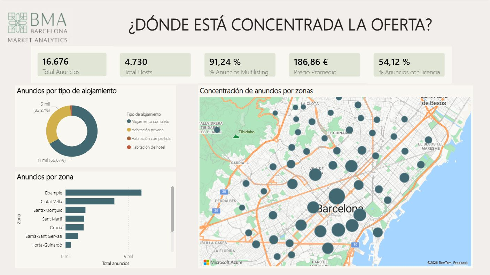
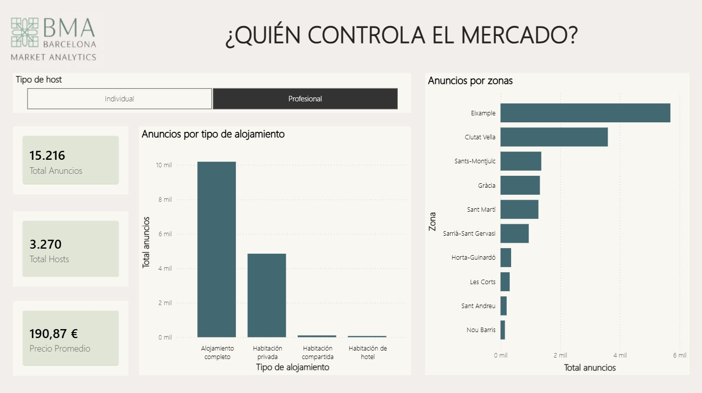
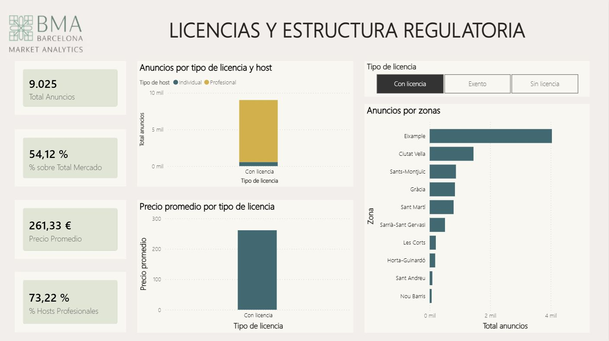
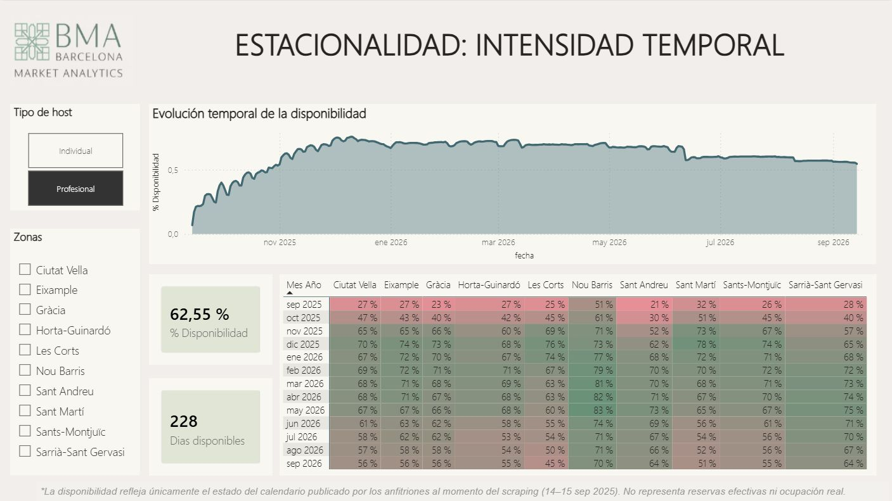
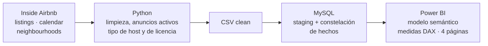
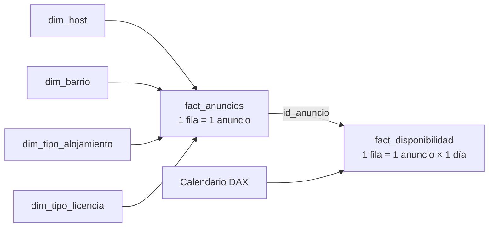

# Airbnb Barcelona 2025 · Análisis del mercado de viviendas turísticas

Análisis descriptivo de la oferta de Airbnb en Barcelona, construido de punta a punta con **Python → MySQL → Power BI**.

El proyecto responde a una pregunta de negocio concreta: **cuál es la dimensión y la composición actual del mercado de viviendas de uso turístico en Barcelona, en volumen, precios, tipología de alojamiento y cumplimiento normativo**. Es una foto del mercado al **14/9/2025**, la fecha del scraping.

> **Datos reales y públicos, proyecto académico en equipo.** Los datos provienen de [Inside Airbnb](https://insideairbnb.com/get-the-data/) (edición Barcelona, septiembre de 2025). El encargo es simulado: el equipo actuó como una consultora ficticia, Barcelona Market Analytics (BMA), para un cliente también ficticio, Mediterranean Urban Investments (MUI), una inversora inmobiliaria. Proyecto integrador de un equipo de cuatro personas (ver [Equipo](#equipo)).

---

## Origen de los datos

Los datos son reales y públicos. Los publica [Inside Airbnb](https://insideairbnb.com/get-the-data/), un proyecto independiente que recopila por web scraping la información visible en los anuncios de Airbnb. No son datos oficiales de la plataforma ni registros de reservas.

| Archivo | Qué registra | Corte |
|---|---|---|
| `listings` | Un anuncio por fila: host, barrio, tipo de alojamiento, precio y licencia | 19.410 anuncios del scraping del 14/9/2025 (16.676 activos tras la limpieza) |
| `calendar` | Un anuncio por día: disponibilidad publicada | 14/9/2025 a 14/9/2026 |
| `neighbourhoods` | Barrios y distritos de Barcelona | 73 barrios, 10 distritos |

Saber cómo se genera el dato define qué se puede concluir. Como sale del anuncio y no de una transacción, refleja lo que el anfitrión declara (precio listado, calendario, licencia) y no lo que efectivamente ocurre. Por eso el análisis habla de oferta y no de demanda u ocupación, y por eso "exento" se trata como una declaración no verificada.

---

## Dashboard

**1. ¿Dónde está concentrada la oferta?** Volumen de anuncios y hosts, precio promedio, tipología de alojamiento y mapa de concentración por zona. Captura sin filtros.



**2. ¿Quién controla el mercado?** Anuncios, hosts y precio según el tipo de host, con desglose por tipología y por zona. Captura con el filtro *Profesional* activo.



**3. Licencias y estructura regulatoria.** Anuncios por tipo de licencia y de host, precio promedio por licencia y distribución por zona. Captura con el filtro *Con licencia* activo.



**4. Estacionalidad.** Evolución diaria de la disponibilidad publicada entre septiembre de 2025 y septiembre de 2026, y mapa de calor por zona y mes. Captura con el filtro *Profesional* activo.



---

## Hallazgos clave

| | Cifra | Lectura |
|---|---|---|
| Tamaño del mercado | 16.676 anuncios · 4.730 hosts | Anuncios activos (con al menos un día disponible en el año) sobre 19.410 del scraping original. |
| Profesionalización | 91,2% de los anuncios | Pertenecen a hosts con más de un anuncio. Esos hosts son el 69,1% del total y gestionan 4,65 anuncios de media. No es un mercado de particulares. |
| Concentración geográfica | 59,6% en dos distritos | Eixample (36,3%) y Ciutat Vella (23,3%) reúnen casi seis de cada diez anuncios. Los distritos periféricos quedan muy por debajo. |
| Tipología | 66,7% alojamiento completo | Con la habitación privada suman el 98,9% de la oferta. Las habitaciones compartidas y de hotel son marginales. |
| Licencias | 54,1% con licencia | El 24,0% declara no tener licencia y el 21,9% figura como exento. |
| Precio y licencia | €261 vs. ~€97 | Precio promedio por noche de los anuncios con licencia frente a los sin licencia o exentos. Dentro de los anuncios con licencia, los de hosts profesionales promedian €264, un 22% más que los de particulares (€217). |
| Precio por zona | €221,87 en Eixample | Es el distrito con el precio promedio más alto. El promedio de todo el mercado es €186,86. |

---

## Limitaciones

- **Oferta declarada, no demanda.** La disponibilidad refleja el calendario publicado por los anfitriones al momento del scraping, no reservas ni ocupación efectiva.
- **Foto estática.** Es un corte transversal de septiembre de 2025. No muestra la evolución del mercado ni el efecto de cambios regulatorios.
- **Precios sesgados por valores extremos.** El promedio (€186,86) está muy por encima de la mediana (€131), con precios de hasta €10.000 por noche. Además, 1.521 anuncios (9,1%) no publican precio y quedan fuera de las medidas de precio.
- **Precio listado.** Es el precio del día del scraping. No incorpora estacionalidad ni precios dinámicos.
- **"Exento" es una declaración del anfitrión, no una verificación.** El 21,9% de los anuncios declara estar exento de licencia. El dataset no permite comprobar si esa exención es válida, así que no se puede asumir que esos anuncios sean irregulares ni que sean legales. Por eso se informan separados del 24,0% sin licencia.
- **Fuente de terceros y una sola plataforma.** Inside Airbnb no es un dato oficial de Airbnb, y el análisis no cubre otras plataformas de alquiler turístico.

El detalle está en el apartado 3.3 y en el capítulo 9 del informe técnico.

---

## Arquitectura



Cada herramienta tiene un rol definido:

- **Python** limpia y transforma los tres datasets, filtra los anuncios activos y crea las variables derivadas: precio por persona, tipo de host y tipo de licencia.
- **MySQL** carga los CSV limpios en tablas staging y construye un esquema de constelación de hechos con dos procesos de negocio de granularidad distinta.
- **Power BI** importa el modelo, suma una tabla Calendario en DAX para el análisis temporal y presenta el dashboard en cuatro páginas.

### Modelo de datos



`fact_disponibilidad` no comparte dimensiones descriptivas con `fact_anuncios`: se vincula solo por `id_anuncio`, y su análisis temporal en Power BI se hace a través de la tabla Calendario.

---

## Estructura del repositorio

```
airbnb-barcelona-2025-python-sql-powerbi/
├── data/
│   ├── raw/                  # listings.csv y neighbourhoods.csv de Inside Airbnb (sin modificar)
│   └── clean/                # listings_clean.csv y neighbourhoods_clean.csv
├── python/notebooks/
│   ├── 01_limpieza_listings.ipynb
│   ├── 02_limpieza_calendar.ipynb
│   └── 03_limpieza_neighbourhoods.ipynb
├── sql/
│   └── airbnb_barcelona_2025.sql          # esquema, carga y modelo dimensional
├── power_bi/
│   └── airbnb_barcelona_2025.pbix
├── documentos/
│   ├── Informe_tecnico_Airbnb_Barcelona_2025.pdf  # metodología, modelo, DAX, hallazgos y diccionario de datos
│   └── Presentacion_Airbnb_Barcelona_2025.pdf     # presentación al cliente
├── assets/                   # capturas del dashboard
└── requirements.txt
```

**Archivos que no están en el repositorio por su tamaño:** `data/raw/calendar.csv`, `data/raw/listings.csv.gz`, `data/clean/calendar_limpio_filtrado.csv` y el dump de MySQL. Los dos primeros se descargan de Inside Airbnb y el tercero se regenera con el notebook `02`.

---

## Cómo reproducirlo

**Requisitos:** Python 3.11+, MySQL 8.x, MySQL Connector/NET y Power BI Desktop (Windows).

1. **Python**
   ```bash
   pip install -r requirements.txt
   ```
   - Descargá de [Inside Airbnb](https://insideairbnb.com/get-the-data/) los archivos `calendar.csv` y `listings.csv.gz` de Barcelona, edición de septiembre de 2025. Puede que esa edición ya no esté publicada en la web.
   - Los notebooks leen y escriben los CSV en la carpeta desde donde se ejecutan. Copiá ahí los archivos de `data/raw/` y los descargados.
   - Ejecutalos en orden: `01` genera `listings_clean.csv`, `02` usa `calendar.csv` y `listings_clean.csv` para generar `calendar_limpio_filtrado.csv`, y `03` genera `neighbourhoods_clean.csv`.

2. **MySQL**
   - Habilitá `local_infile` (`SET GLOBAL local_infile = 1;`).
   - Antes de ejecutar `sql/airbnb_barcelona_2025.sql`, cambiá las rutas de las sentencias `LOAD DATA LOCAL INFILE`: hoy apuntan a la carpeta local de una integrante del equipo.
   - El script crea la base `airbnb_barcelona_2025`, las tablas staging, las dimensiones y las tablas de hechos.

3. **Power BI**
   - Abrí `power_bi/airbnb_barcelona_2025.pbix`.
   - En **Obtener datos → MySQL**, conectá a `localhost` / `airbnb_barcelona_2025`. Si hace falta, instalá MySQL Connector/NET 8.0.29.
   - Hacé clic en **Actualizar**.

---

## Documentación

El **informe técnico** (`documentos/Informe_tecnico_Airbnb_Barcelona_2025.pdf`) recoge el contexto regulatorio, la metodología, el procesamiento en Python, el modelo en SQL, las medidas DAX, la estructura del dashboard, los hallazgos, las recomendaciones y el diccionario de datos.

La **presentación** (`documentos/Presentacion_Airbnb_Barcelona_2025.pdf`) resume el análisis para el cliente: contexto, preguntas, dashboard, conclusiones y recomendaciones.

---

## Equipo

| Nombre | Rol |
|---|---|
| Martina Cottura | Consultoría y análisis |
| Fernando Ferrari | Consultoría y análisis |
| Andrea Marques | Consultoría y análisis |
| Mario Paoloni | Consultoría y análisis |

Proyecto integrador · Python, SQL y Power BI · 2025.

Los datos son públicos y provienen de Inside Airbnb, bajo sus términos de uso. Incluyen el nombre público del anfitrión tal como figura en Airbnb.

[GitHub de Martina Cottura](https://github.com/martina-cottura)
